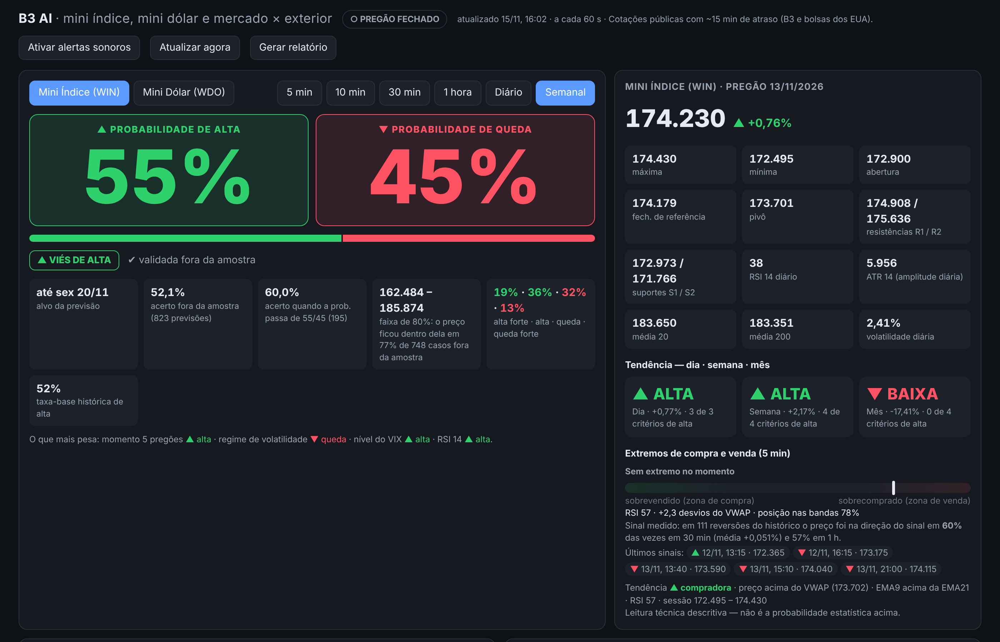

# B3 AI — mercado brasileiro × exterior, probabilidades do mini índice

Painel local (somente leitura, **nunca envia ordens**) em Python puro, sem dependências.

```bash
python -m b3_ai painel        # abre http://127.0.0.1:8766   (Windows: scripts\rodar_b3_ai.bat)
python -m b3_ai relatorio     # grava relatorios/relatorio_AAAAMMDD_HHMM.md e .html
python -m b3_ai analise       # quadro de probabilidades no terminal
```



## O que o painel mostra

| Bloco | Conteúdo |
| --- | --- |
| Alertas | 🚨 ALERTA quando a chance de alta ou de queda passa de 90 % (⚠️ ATENÇÃO a partir de 75 %), 🔄 sinal de reversão, 📅 evento de alto impacto hoje/amanhã. Som, notificação do navegador e Telegram (opcional) |
| Destaque | número verde grande = probabilidade de ALTA; vermelho grande = probabilidade de QUEDA, para o ativo (WIN ou WDO) e o horizonte escolhidos; faixa de preço de 80 % |
| Tendência e extremos | tendência do dia, da semana e do mês; extremo de compra/venda em 5 min (RSI, bandas, VWAP) e sinal de reversão com o acerto medido |
| Síntese para decisão | quantas frentes independentes (estatística, exterior, notícias, analistas, Focus, amplitude, técnica) apontam para cada lado |
| Opinião sobre os dados | botão que analisa tudo o que está na tela e escreve a opinião na hora, sem custo; outro botão leva os dados prontos para o Claude |
| Quadro de probabilidades | 5 min · 10 min · 30 min · 1 hora · fecho de hoje (com pregão aberto) · diário · semanal, com sinal, validação e acerto fora da amostra |
| Confronto exterior × Brasil | quanto os mercados internacionais implicavam para o ativo, quanto ele fez, o descolamento e a contribuição de cada fator |
| Notícias e deduções | tema, cadeia de causa e efeito, setores e ações atingidos com a variação real do dia (o mercado confirmou a notícia?) e o efeito medido no histórico do mini índice |
| Agenda | decisões de juros dos EUA (calendário oficial do Fed) e do Copom (Banco Central), payroll e eventos do `dados/agenda.json`, com o efeito histórico dos dias de Fed |
| Analistas e economistas | boletim Focus com revisões, consenso de recomendações das casas para as ações da B3, manchetes de casas de análise e notícias por empresa × reação da ação |
| Mercados internacionais | S&P, Nasdaq, DXY, Treasuries, VIX, Brent, minério, cobre, emergentes, China, Europa, ouro, bitcoin; Brasil em NY (EWZ, ADRs) |
| B3 — todas as empresas | ações, BDRs, FIIs e ETFs: amplitude, setores, maiores altas/quedas e tabela completa com busca, filtros e ordenação |
| Placar ao vivo | cada previsão é gravada antes do resultado e conferida depois contra o preço real |
| Relatório | botão "Gerar relatório" (HTML imprimível/PDF e Markdown) do mini índice e do mini dólar |

## De onde vêm os dados (todos reais, sem chave)

| Dado | Fonte |
| --- | --- |
| Todas as empresas da B3, cotações, setores, indicadores | TradingView scanner (`data/tradingview.py`) |
| Histórico diário e intraday de WIN, WDO e fatores internacionais | feed público da TradingView (`data/ws.py`, WebSocket em Python puro); reserva: Yahoo (só diário) |
| Selic, PTAX, IPCA | Banco Central — SGS (`data/bcb.py`) |
| Notícias | RSS do Google Notícias (buscas temáticas BR e exterior), InfoMoney e G1 (`data/news.py`) |
| Consenso dos economistas | boletim Focus — Banco Central, API Olinda (`data/focus.py`) |
| Agenda | calendário de reuniões do Federal Reserve e próxima reunião do Copom (`data/calendar.py`) |

Cotações públicas da B3 e das bolsas americanas chegam com **~15 minutos de atraso**. As fontes da TradingView são
endpoints públicos não oficiais: podem mudar sem aviso; quando o histórico falha o motor cai para o Yahoo e avisa no painel.

## Como as probabilidades são calculadas (`model.py`)

1. **Confronto (fair value)** — regressão ridge móvel (250 pregões, ponto-a-ponto) do retorno diário do alvo sobre os
   fatores internacionais do mesmo dia. Dá o "exterior implícito", o descolamento e a contribuição de cada fator.
2. **Diário e semanal** — regressão logística sobre o estado no fechamento: exterior implícito, descolamento,
   momento de 5 pregões, RSI, distância da média de 20, nível do VIX, ativo cruzado (dólar ↔ bolsa) e regime de
   volatilidade. Com a B3 fechada, o que o exterior andou depois do fechamento desloca a probabilidade.
3. **Intraday (5, 10, 30 min, 1 h)** — regressão logística em barras de 5 e 15 min: momento do ativo, S&P futuro,
   dólar, VWAP, RSI, gap de abertura e hora do pregão.
4. **Validação e calibração** — todo modelo roda em walk-forward (treina no passado, prevê o trecho seguinte) e a
   probabilidade final é `base + k · (modelo − base)`, com `k` medido nas previsões fora da amostra. **Sem poder
   preditivo comprovado, k → 0 e o número volta para ~50 %** — o painel marca "não validado" em vez de inventar convicção.

Medido em 15/11/2026 com o histórico real: o modelo diário do WIN acertou a direção em ~54 % de 825 pregões fora da
amostra; os horizontes intraday ficaram em ~47–53 % (sem vantagem comprovada com dado público atrasado em 15 min) e por
isso aparecem perto de 50/50. As barras intraday são acumuladas em `dados/b3_ai.db` a cada ciclo, então a amostra desses
modelos cresce enquanto o painel roda.

As notícias são classificadas por regras (`news_ai.py`) e mostradas **ao lado** da probabilidade — não entram no cálculo,
porque não há histórico de manchetes para validá-las fora da amostra.

## O que acerta 80 % ou mais — e o que não acerta

Medido no histórico real (15/11/2026). O painel mostra sempre o número medido, nunca um número prometido.

| Previsão | Acerto medido | Observação |
| --- | --- | --- |
| Faixa de preço de 80 % (todos os horizontes) | 77–83 % fora da amostra | o preço ficou dentro da faixa nessa proporção; serve para alvo e stop |
| Choque no exterior → pregão do mini índice | dólar disparando: queda em 94 % de 93 pregões; VIX disparando: queda em 81 % de 98 | relação no MESMO pregão; dispara ALERTA/ATENÇÃO quando o choque está acontecendo |
| Fecho do dia × fechamento anterior | 95 %+ quando o dia já andou meio desvio | referência é o fechamento anterior, não o preço atual: não é vantagem para quem entra agora |
| Direção do próximo pregão (WIN) | ~54 % em 825 pregões | vantagem pequena e real |
| Direção em 5 min a 1 h | 47–53 % | sem vantagem comprovada com dado público atrasado em 15 min |
| Sinal de reversão em extremos (WIN, 30 min) | ~60 % em 111 sinais (67 % na 1ª metade, 53 % na 2ª) | instável; no mini dólar ficou abaixo de 50 % |

Prever a DIREÇÃO do preço a partir de agora com 80 % de acerto não é alcançável de forma honesta — nem por este sistema nem
por outro; quem mostra esse número em backtest ajustou o modelo ao passado. O que o painel faz é separar o que é confiável
(faixas, choques, contexto) do que é quase cara-ou-coroa, e avisar quando algo raro e forte acontece.

## Opinião sobre os dados (sem custo)

Dois botões no painel, os dois usando só o que já está na tela:

- **Analisar agora** — o painel lê probabilidades, tendência, exterior, notícias, analistas, agenda e níveis e escreve a
  opinião na hora (`opinion.py`, regras de leitura de mercado; local, sem chave e sem serviço pago). No terminal:
  `python -m b3_ai opiniao`.
- **Levar os dados para o Claude** — copia os mesmos dados, com as instruções, e abre o claude.ai; basta colar na conversa
  para o Claude dar a opinião dele usando a sua conta. Nada é enviado automaticamente.

## Limites

Probabilidade não é garantia. Direção de curto prazo é quase um cara-ou-coroa; uma vantagem de poucos pontos
percentuais só aparece em muitas operações e some com custos mal controlados. Use o painel como apoio à decisão, junto
com gestão de risco. Não é recomendação de investimento.
